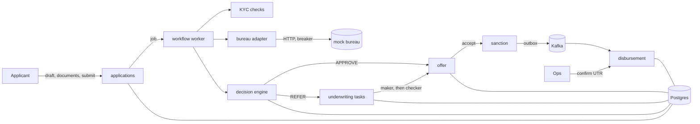

# LendFlow

A loan origination service for personal and home loans: an applicant fills in a draft, uploads KYC documents and
submits; LendFlow checks the documents and the PAN, pulls a (mock) credit bureau report, runs a versioned rule set and
a points scorecard, and either approves with an offer, rejects with reason codes, or refers the case to people. Referred
cases go through maker-checker underwriting. An accepted offer becomes a sanction and a disbursement handoff that ops
confirm with a bank UTR.

I built it to practise the parts of lending that are easy to get wrong in a real system: decisions you can explain and
replay months later, policy changes that can't go live on one person's say-so, money maths that adds up to the paisa,
and queues where two underwriters can't grab the same file.

Java 21, Spring Boot 3.5, Postgres, Kafka. One deployable, split into modules that each have `domain`, `application`
and `adapter` packages.

## How it fits together



Application lifecycle:

```
DRAFT -> SUBMITTED -> UNDERWRITING -> APPROVED -> SANCTIONED -> DISBURSED
                                   -> REFER -> APPROVED | REJECTED
                                   -> REJECTED
DRAFT | APPROVED -> WITHDRAWN
```

The transitions live in one small table in `application/domain`; every change is written to a history table and an
outbox row in the same transaction.

### The parts worth reading

- **Decision engine** (`decision/domain`). A rule set is JSON: decision tables with FIRST, COLLECT or PRIORITY hit
  policies (eligibility, pricing) plus parameters such as the FOIR cap and the auto-approval limit. A scorecard adds
  points per attribute band and maps the total to a grade. Every decision stores the rule set version, scorecard
  version, the exact facts it saw and the reason codes, so `GET /v1/applications/{id}/decision` can say why, and
  the decision can be replayed. The challenger scorecard (`PL-SC-2`) runs in shadow on every personal loan; the
  divergence shows up in `/v1/shadow-report` and never affects the customer.
- **Policy changes** (`decision/application/RulesetService`). Rule sets are drafted through the API, validated by
  actually parsing them, simulated against the facts recorded for recent decisions (outcome-change matrix), and
  published by a different policy admin than the author. Published versions are never edited; publishing retires the
  previous one. Rolling back means republishing the old definition as a new version.
- **Bureau adapter** (`bureau`). Consent version and time go with every pull, the report is stored once per
  application, and the HTTP client sits behind a resilience4j circuit breaker and bulkhead. If the bureau is down the
  application is referred rather than failed.
- **Workflow** (`workflow`). Submit enqueues a job in Postgres; workers take batches with `FOR UPDATE SKIP LOCKED`,
  hold a lease and retry with exponential backoff up to a cap. A restart doesn't lose work.
- **Underwriting** (`underwriting`). Referred cases open a maker task. Claiming is one conditional `UPDATE`, so exactly
  one of several underwriters gets it. The maker's approval opens a checker task routed through an approval-authority
  chain (credit manager up to a per-product limit, credit head above it); the maker can never be the checker. A
  sweeper escalates tasks past their SLA to the next role.
- **Offers** (`offer`, `shared/money`). EMI uses `P r (1+r)^n / ((1+r)^n - 1)` in `BigDecimal`; the schedule puts the
  rounding residue on the last instalment so principal adds up exactly (checked with jqwik properties). If FOIR caps
  the amount, a binary search finds the largest loan that fits. Acceptance takes an `Idempotency-Key`.
- **Disbursement** (`disbursement`). Listens for `ApplicationSanctioned` on Kafka and creates a handoff; ops confirm it
  with a UTR, and a repeat of the same UTR is a no-op.
- **PII** (`applicant`). PAN, phone and email are stored AES-GCM encrypted, plus a keyed HMAC for lookups and the
  duplicate check (a plain hash of a PAN is brute-forceable). Duplicates match on PAN, phone or email, or on a
  Jaro-Winkler name similarity of at least 0.92 with the same date of birth.

## Running it

You need Docker with Compose. The service refuses to start without its two keys, so create them first:

```bash
export LENDFLOW_DATA_KEY=$(openssl rand -base64 32)
export LENDFLOW_LOOKUP_KEY=$(openssl rand -base64 32)
docker compose up -d --build --wait
./scripts/demo.sh
```

The stack is Postgres, Kafka (KRaft), a mock OAuth2 server for tokens, a WireMock bureau and the app on
`localhost:7990`. The demo walks through an auto-approval to disbursement, a referral with a claim race and
maker-checker sign-off, a decline, and a policy change with simulation, four-eyes publishing and rollback. It needs
`curl` and `jq`.

The mock bureau picks a profile from the first digit of the PAN's number part: 1-2 good, 3 bureau down, 4 average,
5 stretched, 7 slow, 8 poor, 9 no file.

Tokens come from the mock server: client id = user, one scope per token (`lendflow.applicant`, `lendflow.underwriter`,
`lendflow.credit_manager`, `lendflow.credit_head`, `lendflow.policy`, `lendflow.ops`). See `scripts/lib.sh`.

To run the tests: `mvn verify` (needs Docker for Testcontainers).

## API

| Method | Path | Who | What |
|---|---|---|---|
| POST | `/v1/applications` | applicant | create a draft |
| PATCH | `/v1/applications/{id}` | applicant | update a draft |
| POST | `/v1/applications/{id}/documents` | applicant | upload a KYC document (multipart `type`, `file`) |
| GET | `/v1/applications/{id}/documents` | applicant, staff | documents and their check status |
| POST | `/v1/applications/{id}/submit` | applicant | submit, starts the workflow |
| POST | `/v1/applications/{id}/withdraw` | applicant | withdraw a draft or an unaccepted approval |
| GET | `/v1/applications/{id}`, `/history` | applicant, staff | status and transitions |
| GET | `/v1/applications/{id}/decision` | applicant, staff | outcome, score, grade, reason codes, versions |
| GET | `/v1/applications/{id}/offer`, `/v1/offers/{id}` | applicant | the offer |
| GET | `/v1/offers/{id}/schedule` | applicant | amortization schedule |
| POST | `/v1/offers/{id}/accept` | applicant | accept (`Idempotency-Key` header) |
| GET | `/v1/offers/{id}/sanction-letter` | applicant | plain-text sanction letter |
| GET | `/v1/tasks` | underwriter, managers | queue |
| POST | `/v1/tasks/{id}/claim`, `/complete` | underwriter, managers | claim; APPROVE/DECLINE as maker, CONFIRM/SEND_BACK as checker |
| POST, GET | `/v1/rulesets`, `/v1/rulesets/{id}` | policy | draft and read rule sets |
| POST | `/v1/rulesets/{id}/simulate`, `/publish` | policy | replay recent decisions; publish (not by the author) |
| GET | `/v1/shadow-report` | policy, credit head | champion vs challenger |
| GET | `/v1/disbursements?application=`, `/{id}` | ops | handoffs |
| POST | `/v1/disbursements/{id}/confirm` | ops | confirm with a UTR |

Errors are RFC 7807 problem details with a stable `code`.

## Tests

110 unit tests and 53 integration tests, all green locally and in CI.

- Unit: state machine transitions, hit policies, scorecard banding, a golden-file test of decisions over a fixed set
  of applicants, simulation, EMI and schedule (including jqwik properties that principal always sums to the loan),
  approval-authority routing, Jaro-Winkler, PII protection.
- Integration (Testcontainers Postgres and Kafka, WireMock bureau): the whole flow per bureau profile, bureau outage
  and breaker, concurrent edits and submits of one application, workers racing for one job, eight underwriters
  racing for one claim, concurrent and repeated offer acceptance, SLA escalation, maker-checker rules, policy
  simulate/publish with four eyes, disbursement handoff and UTR idempotency, and role checks on the API.
- ArchUnit: domain code doesn't touch Spring, JDBC, Kafka or the outer layers; application code doesn't touch adapters.

CI runs the tests, builds the image, scans it with Trivy (fails on fixable HIGH/CRITICAL), and runs the compose
stack with `demo.sh` and a short bench.

## Numbers

From `scripts/bench.sh` (40 clean applications, 8 at a time, each timed from the submit call until the API shows a
decision, polling every 50 ms), four runs on the compose stack:

| | p50 | p95 | outcome |
|---|---|---|---|
| submit to decision | 424-474 ms | 485-566 ms | 40/40 approved each run |
| 8 concurrent accepts of one offer, different idempotency keys | | | 1 accepted, 7 got 409 |

The latency is mostly the workflow worker's 500 ms poll interval (`lendflow.workflow.poll-ms`): a job waits on
average half a poll before anyone picks it up. The bureau call, the decision and the offer are a small part of it.
Lowering the interval would lower the number and cost more idle queries. These were measured on a shared 8-vCPU
Linux box with other workloads running and Docker on a remote daemon, so treat them as a rough order, not a
benchmark.

From the demo, a 3,00,000 personal loan over 36 months for a good bureau file: score 670, grade A, auto-approved
under `PERSONAL-v1` / `PL-SC-1`, at 10.50% p.a., EMI 9,750.73, processing fee 3,000 plus 540 GST, net disbursal
2,96,460, total interest 51,026.39.

The runtime image is 266 MB (JRE on Alpine, non-root user).

## Design decisions

- **One service, not six.** The Page draws separate services. The module boundaries are the same, enforced with
  ArchUnit, but one process keeps transactions simple: status change, history and outbox row commit together.
- **Rule sets are data.** JSON with a version, validated by parsing, immutable once published. The decision engine
  caches parsed versions by id, which needs no invalidation because versions never change.
- **Reason codes are part of the contract.** Eligibility rules and scorecard attributes each carry a code; the decision
  returns the most significant ones (capped by `reasonLimit`), so a rejection always says why.
- **Bureau trouble means people, not failure.** Timeouts retry with backoff, then the application is referred.
- **Claims are a conditional update**, not a lock held while someone reads a file. Re-claiming a task you already hold
  returns 200, so a double click is harmless.
- **Outbox to Kafka** for workflow events, so an event is published if and only if its transaction committed.

## Differences from the Page

All of these are simplifications.

- **No MinIO.** Documents are stored as `bytea` in Postgres (2 MB cap). Fine at this scale; object storage would be
  the move for real volumes.
- **No db-scheduler.** Workflow jobs are a small `SKIP LOCKED` queue and SLA timers are a periodic sweeper over task due
  times. Both are persisted, so restarts don't lose them, which was the point of the library on the Page.
- **No Angular console.** API only; the demo script plays the UI.
- **Duplicate check is blocked by date of birth**, not by phone or PAN prefix: exact PAN, phone and email matches are
  HMAC lookups already, so the fuzzy pass only needs to look at people born on the same day.
- **Keys come from environment variables**, not a KMS.
- **Policies are seeded from JSON files** on first start; later versions go through the API.
- **Events for all lifecycle changes share one applications topic.**

## Known limitations

- The numbers in the policies (rates, GST, fees, SLAs, approval limits, score bands) are illustrative, not anyone's
  real credit policy.
- KYC document checks are format and completeness only (file type, size, required types). There is no OCR or face
  match, and the PAN check is name similarity against the mock registry. Documents can only be uploaded while the
  application is a draft, and a failed PAN check can't be retried in place.
- No bank account capture or penny-drop; disbursement only checks the UTR's shape.
- If the bureau was down there is no decision to approve against, so a maker can only decline such a case.
- Jobs that run out of attempts stay FAILED; there is no requeue endpoint, and backoff has no jitter.
- PRIORITY hit policy keeps every rule tied at the top priority rather than picking one.
- Offer expiry is evaluated when the offer is read; nothing sweeps expired offers. The schedule has instalment numbers
  but no due dates.
- Checkers can confirm or send back but can't change the amount.
- Disbursement is an in-process Kafka consumer with no foreign key to the application. Two concurrent confirmations
  with the same UTR are stopped by a unique index, but the loser gets a 500 instead of a clean answer.
- Simulation replays the facts stored at decision time, so ages and bureau data are as of the original decision.
  Publishing doesn't require a simulation first; an advisory lock serializes concurrent publishes per product.
- No retention jobs for bureau reports or rejected applications yet; only the outbox is purged.
- The mock OAuth server issues one scope per token, so a user with two roles needs two tokens.
- The integration tests widen the circuit breaker's window so its thresholds can be hit deterministically.
- The demo and bench randomise dates of birth, phones and emails per run so reruns don't trip the duplicate check
  against earlier runs.
